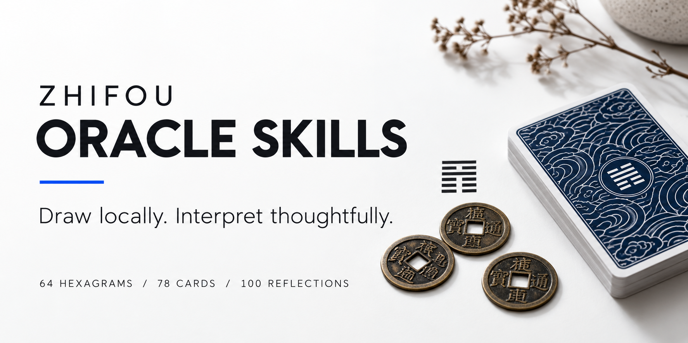

<p align="center"></p>

# Zhifou Oracle Skills

**I Ching and tarot for agents that should interpret the draw, not invent it.**

[简体中文](README.zh-CN.md) · [Download Skill](https://github.com/moka992/zhifou-oracle-skills/releases/latest) · [Method & Sources](skills/zhifou-oracle/references/sources.md) · [Evaluation](evals/README.md)


A portable Agent Skill with offline three-coin I Ching casting, Rider-Waite-Smith tarot, and original reflection cards. Local code fixes the outcome and retrieves the relevant references; your agent connects them to the question. No API key, server, or runtime Python package is needed by the tools. The host model can still require a subscription or paid API.

Built from [Zhifou Fortune](https://github.com/moka992/zhifou-fortune), an Android app with the same offline reading foundations. This repository is the standalone skill, not the app or its user data.

## What Makes It Useful

| Capability | What is included |
| --- | --- |
| Three-coin I Ching | Six bottom-to-top casts, correct 1:3:3:1 line distribution, moving lines, transformed hexagram, and one declared Zhu Xi-style selection policy |
| Source-backed reference | 64 hexagrams, 384 line texts, Tuan, Xiang, and Use Nine / Use Six, with explicit corpus attribution |
| Rider-Waite-Smith | All 78 historical card fronts, a card back, English/Chinese names, and modern Chinese upright/reversed reference summaries |
| Spreads | Single card, modern three-card reflection, and ten-card Celtic Cross without a separate significator |
| Original reflection cards | 100 entries inspired by the answer-book format, not copied from a commercial book |
| Stable records | Imported draws stay fixed; a receipt and verifier check arithmetic, selected passages, positions, and orientations |
| Portable instructions | Standard `SKILL.md`, progressive references, concise runtime prompts, and optional Codex UI metadata |

The point is better-grounded interpretation, not a claim that divination predicts outcomes. No real birthday, location, or stated question is required.

## Try It in a Minute

```sh
git clone https://github.com/moka992/zhifou-oracle-skills.git
cd zhifou-oracle-skills
python3 skills/zhifou-oracle/scripts/oracle.py tarot --spread three-card
python3 skills/zhifou-oracle/scripts/oracle.py coin --lines 7,8,7,8,7,8
```

The second command imports a fixed cast, rather than pretending it is a random draw. Omit `--lines` for a new cast. Each command prints a JSON reading and the relevant references, not an LLM-written answer. An agent supplies the interpretation after loading the skill.

```text
Use $zhifou-oracle for a three-coin reading about a difficult work decision.
Focus on the actual question, cite the selected passage, and suggest a small next step.
```

In Claude Code, use `/zhifou-oracle` instead of `$zhifou-oracle`.

## Install the Skill

From this cloned repository, choose the target project:

```sh
python3 tools/install_skill.py --host codex --project /path/to/your-project
python3 tools/install_skill.py --host claude --project /path/to/your-project
```

These create `.agents/skills/zhifou-oracle` or `.claude/skills/zhifou-oracle` inside the chosen project. The installer refuses to overwrite an existing installation. Use either command for the intended host, not both by default. Reload skill discovery if your host requires it.

The [release ZIP](https://github.com/moka992/zhifou-oracle-skills/releases/latest) contains a self-contained `zhifou-oracle/` directory with its references, scripts, data, artwork, and license notices. Other Agent Skills hosts can install that directory according to their own documentation. Host-specific tool and image support varies; this is not a blanket certification of every model or platform.

## Keep a Draw, Then Interpret It

<p>  </p>

```sh
python3 skills/zhifou-oracle/scripts/oracle.py tarot --spread single --cards '[{"card_id":"major_08","reversed":true}]'
python3 skills/zhifou-oracle/scripts/oracle.py lookup --hexagram 1
python3 skills/zhifou-oracle/scripts/oracle.py lookup --card cups_02
python3 skills/zhifou-oracle/scripts/oracle.py answer --page 43
```

For private questions, prefer `--question-stdin` to putting them in shell history. Readings are printed, not stored or transmitted by the script. A host's conversation history or API provider may retain them. Keep saved readings outside the repository.

Use `verify path/to/reading.json` to check a saved receipt. This validates consistency, **not** the authenticity of a physical draw, a cryptographic signature, or the truth of an interpretation. The user's question is deliberately outside the outcome checksum.

## For Application Developers

Use [the runtime prompts](skills/zhifou-oracle/prompts) and a structured reading record in your existing model integration. `AGENTS.md` is for maintaining this codebase; it is not automatically sent to an API model. Load only the selected method and relevant records, not the entire reference pack. The skill does not change model selection, provider credentials, reasoning settings, or output budgets.

An [Android exporter](tools/export_android.py) generates Kotlin prompt constants from the same files. See [integration notes](skills/zhifou-oracle/references/integration.md) and [prompt design notes](docs/prompt-design.md).

## Verification and Limits

```sh
python3 -m unittest discover -s tests -v
python3 tools/check_release.py
python3 tools/package_skill.py
```

The deterministic suite covers all **4,096 possible six-line value combinations**, the coin-face distribution, source selection, complete catalogs, unique tarot draws, imported orientations, receipt tampering, safe context filtering, and private stdin. These are software-correctness checks, not evidence of predictive validity.

[Behavioral cases](evals/cases.json) cover question relevance, a silent question, ominous tarot imagery, source fidelity, prompt injection, and high-stakes requests. Model-specific quality must be evaluated separately. We do not claim a success rate or a quality gain across untested API models.

## Sources and License

- **MIT:** original code, prompts, original reflection entries, and modern summaries.
- **CC BY-SA 4.0:** the adapted Kanseki Zhou Yi dataset. This data is not relicensed as MIT.
- **Historical public-domain artwork:** Pamela Colman Smith's original 1909 RWS deck, with source notices retained.

See [notices](skills/zhifou-oracle/NOTICE.md), [sources](skills/zhifou-oracle/references/sources.md), and [security](SECURITY.md). Classical material, later interpretive conventions, and modern advice are intentionally distinguished. This project is independent of OpenAI, Anthropic, and the cited archives.

## Contribute

Source corrections, realistic failure cases, translations, and host-integration examples are welcome. Start with [CONTRIBUTING.md](CONTRIBUTING.md). If this is useful in your workflow, a star helps others discover it; an issue with a reproducible example helps improve it.
