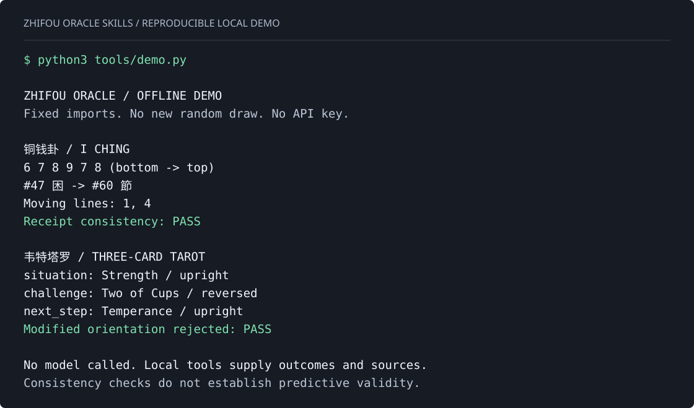

# A Reading You Can Reproduce / 可复现案例

[English](#english) · [简体中文](#简体中文) · [Offline demo](../tools/demo.py)

## English

This walkthrough uses fixed **imported** outcomes, not new random draws. The local example runs without an API key, a server, additional Python packages, or an agent subscription:

```sh
git clone https://github.com/moka992/zhifou-oracle-skills.git
cd zhifou-oracle-skills
python3 tools/demo.py
```

The demo imports the bottom-to-top line values `6,7,8,9,7,8`, resolves hexagram 47 (困) to 60 (節) with lines 1 and 4 moving, and checks the record against the source data and declared selection policy. It also imports the three-card example below, verifies it, then deliberately changes an orientation and checks that verification rejects the altered record.



The image is generated from the command's actual output by `python3 tools/render_demo.py`. It is not an AI answer or an image of a hosted model session. `python3 tools/demo.py --json` prints a compact demo summary; use the original CLI for a full reading receipt:

```sh
python3 skills/zhifou-oracle/scripts/oracle.py coin --lines 6,7,8,9,7,8
python3 skills/zhifou-oracle/scripts/oracle.py tarot --spread three-card --cards '[{"card_id":"major_08","reversed":false},{"card_id":"cups_02","reversed":true},{"card_id":"major_14","reversed":false}]'
```

### From Data to Interpretation

**Example question:** I am considering a career change. What should I examine before committing?

| Position | Imported card | Reading focus |
| --- | --- | --- |
| Situation | Strength, upright | Composure, patience, and existing capability |
| Challenge | Two of Cups, reversed | Expectations or cooperation that need clarification |
| Next step | Temperance, upright | A measured transition and a small test |

**Example interpretation, written for this guide:**

You do not need a dramatic leap to prove you are ready for a change. Strength suggests starting with what you can already do well. The reversed Two of Cups draws attention to the agreement itself: are the role, support, and expectations as clear to the other side as they are to you? Temperance points toward a staged move. Before resigning, ask for a specific account of the first three months and test one piece of the work. The useful question is not simply whether to leave, but what evidence would make the move worth taking.

This paragraph is an editorial example, **not** a recorded model response, a model benchmark, or a prediction. When used inside an agent, the model writes its own interpretation from the fixed cards, method prompt, and question. That host may require a subscription or paid API. The three-card layout is a modern reflection spread, not Waite's ten-card Celtic method.

### What to Check

- The interpreter must retain the same cards and orientations; it must not redraw a more convenient answer.
- A paraphrase must not be presented as a quotation from Waite or the Zhou Yi.
- The response should connect the symbols to the actual question instead of returning a glossary.
- Receipt verification checks internal consistency, not the authenticity of a physical draw, cryptographic authorship, or predictive validity.

For sources and the separately licensed corpus/artwork, see [NOTICE](../skills/zhifou-oracle/NOTICE.md). To report a problem, include a synthetic example rather than private conversations or credentials.

## 简体中文

这是一个**固定导入结果**的完整示例，不是重新随机抽取。克隆仓库后运行：

```sh
python3 tools/demo.py --lang zh
```

演示会导入自下而上的六爻 `6,7,8,9,7,8`，得到困卦、初爻与四爻动、变为节卦，并核对结果和取文规则。随后导入「力量正位、圣杯二逆位、节制正位」，校验结果，再故意改动一张牌的正逆位，确认不一致的记录会被拒绝。程序不调用模型、不需要 Key，也不保存真实用户问题。

**示例提问：**我正在考虑换工作，决定之前最应该看清什么？

**为本说明撰写的示例解读，并非模型实测输出：**

你不必通过一次很大的跳跃，证明自己已经准备好了。力量正位更像是在提醒你，先盘点那些已经做得稳的事。圣杯二逆位把问题引向双方的约定：职位、支持和期待，是否真的说清楚了？节制正位则适合一个分阶段的转变。辞职之前，先问清新岗位前三个月具体做什么，再找一小块工作验证匹配程度。与其只问「走不走」，不如先弄清，什么证据会让这次改变值得。

接入宿主 Agent 后，模型会结合固定结果、方法说明和用户问题自行组织回答；宿主仍可能需要订阅或 API 费用。这个现代三牌反思布局不冒充韦特十张十字牌阵，结果校验也不代表预测能力得到验证。原文、历史牌面和现代概括的授权边界见 [NOTICE](../skills/zhifou-oracle/NOTICE.md)。
